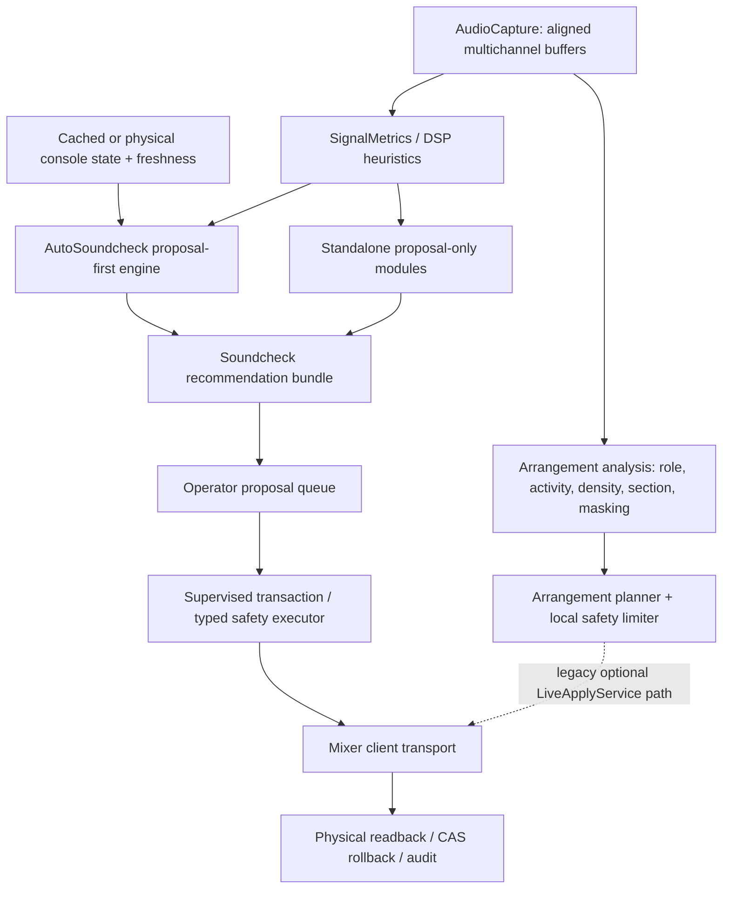
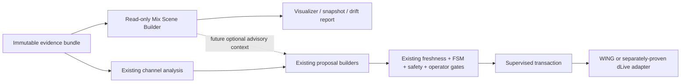

# Mix Scene Model — Architectural Assessment

Date: 2026-08-04
Scope: repository research and planning only
Hardware: disconnected; no mixer contact performed
Implementation changes: none

## 1. Executive Summary

**Recommendation: implement now only as a read-only MVP.** Do not make the Mix
Scene Model canonical state, do not connect it to actuation, and do not use it to
advance dLive or WING readiness.

The idea fits the long-term goal well: Automixer is explicitly expected to
understand sources and arrangement roles and make explainable decisions across
balance, EQ, dynamics, panning, unmasking and phase
(`Docs/PROJECT_GOAL.md:3-13`). The repository already contains most low-level
ingredients: multichannel capture, per-channel features, pairwise correlation,
roles, activity, density, sections, priority, masking, snapshots, proposal-only
recommendations, runtime policy, bounded actions, readback and rollback.

What does **not** exist is the proposed product: there is no canonical
`MixScene`, stable object identity spanning multiple channels, general relation
graph, approved acoustic scene reference, scene-distance contract, or a tested
high-level-goal-to-actions planner. Existing console “scene/snapshot” code stores
channel parameters; it is not a semantic acoustic scene
(`backend/mixer_state.py:325-350`, `backend/mixer_state.py:429-504`).

The codebase also has an architectural reason not to insert a new canonical
state now. It contains several overlapping paths: the proposal-first soundcheck
engine, standalone proposal-only modules, the arrangement controller, the typed
safety executor, Product Layer proposal queue, and supervised transaction
coordinator. In particular, arrangement automation still owns an optional
`LiveApplyService` path (`backend/arrangement_automation/controller.py:28-43`,
`backend/arrangement_automation/controller.py:301-355`). A scene model connected
to those paths prematurely could add a second control loop and make authority
harder to reason about.

The safest useful experiment is a deterministic, transport-free scene builder
fed by existing feature DTOs. It should output immutable objects, relations,
snapshot/drift evidence and an explainable report. It must have no dependency on
mixer clients, FSM mutation, typed correction actions, proposal queue mutation or
live apply. If that read-only slice cannot improve diagnosis on replay fixtures
without unstable identities or false masking claims, stop before integration.

**Total idea score: 79/100.** Research direction: **90/100**. Full integration
right now: **61/100**. Integration after the current soundcheck/control-plane and
hardware gates: **86/100**.

## 2. Repository Evidence

This assessment used current source, tests, configuration and active decision
documents, not filenames alone. The working tree was already heavily modified;
therefore line references describe the inspected 2026-08-04 worktree and may
move after those changes are committed.

| Area | Concrete evidence | Finding |
|---|---|---|
| Project goal | `Docs/PROJECT_GOAL.md:3-26` | Semantic source/role understanding is in scope; broad live autonomy is not the current executable milestone. |
| Capture | `backend/audio_capture.py:27-60`, `backend/audio_capture.py:264-324` | Bounded multichannel ring-buffer service exists, with an explicit silence-fallback flag. |
| Features | `backend/signal_metrics.py:61-140`, `backend/signal_metrics.py:156-185` | Level, dynamics, spectral and per-channel DTOs exist. |
| Pair relations | `backend/signal_metrics.py:104-115`, `backend/signal_metrics.py:527` | Correlation, delay, coherence, spectral similarity and level difference exist pairwise. |
| Source/role state | `backend/auto_soundcheck_engine.py:229-254`; `backend/autofoh_models.py:15-79` | Per-channel role, confidence, stem membership and metrics exist. |
| Arrangement context | `backend/arrangement_automation/models.py:12-104` | Role, activity, density, section, masking source and priority DTOs exist. |
| Arrangement orchestration | `backend/arrangement_automation/controller.py:182-268` | One cycle already combines activity, density, section, priority, masking, planning and limiting. |
| Masking | `backend/arrangement_automation/masking_analyzer.py:25-94`; `backend/heuristics/erb_masking.py:127-241` | A simple lead-centric score and a richer sum-relative ERB model both exist, but do not share one relation schema. |
| Bleed | `backend/heuristics/bleed_leakage.py:1-19`, `backend/heuristics/bleed_leakage.py:68-122` | Bleed-floor and leakage-matrix corrections exist and explicitly remain proposal-only. |
| Phase | `backend/heuristics/phase_v3.py:22-29`, `backend/heuristics/phase_v3.py:64-141`, `backend/heuristics/phase_v3.py:193-257` | Role-aware pair alignment, instability gates and live drift-only doctrine exist. |
| Panning | `backend/pan_spatial_proposal.py:1-6`, `backend/pan_spatial_proposal.py:171-214`, `backend/pan_spatial_proposal.py:221-298` | Spatial evidence and proposal DTOs exist with explicit non-live blockers. |
| Frequency separation | `backend/frequency_separation_proposal.py:1-6`, `backend/frequency_separation_proposal.py:23-64`, `backend/frequency_separation_proposal.py:207-258` | Role-aware unmasking proposals already carry evidence, freshness and promotion blockers. |
| Console state | `backend/mixer_state.py:182-260`, `backend/mixer_state.py:342-387` | Rich per-channel parameter state exists; there is no semantic global scene state. |
| Snapshots | `backend/mixer_state.py:429-504`; `backend/operator_product_state.py:2861-3026` | Parameter snapshots/catalogs exist; console load/save remains blocked/manual-only. |
| FSM | `backend/autofoh_models.py:94-115`; `backend/autofoh_runtime.py:29-42`, `backend/autofoh_runtime.py:45-156` | Runtime state and per-family permissions/evidence durations are explicit. |
| Safety bounds | `backend/autofoh_safety.py:409-505`, `backend/autofoh_safety.py:508-521` | Steps, intervals, totals and a proposal-only direct-write quarantine are explicit. |
| Verified execution | `backend/correction_action_executor.py:390-410`, `backend/correction_action_executor.py:430-675`, `backend/correction_action_executor.py:814-826` | Readback mismatch blocks, triggers rollback and demotes the action type. |
| Proposal queue | `backend/operator_proposal_queue.py:1-6`, `backend/operator_proposal_queue.py:42-61`, `backend/operator_proposal_queue.py:1107-1163` | Queue is not a transport; proposals have TTL and atomic execution claims. |
| Operator modes | `backend/operator_mode_policy.py:147-194`, `backend/operator_mode_policy.py:234-260` | Analyze, Assist, Supervised and Auto have different proposal/write policies. |
| Audit/memory | `backend/automation_trace.py:201-253`; `backend/decision_memory.py:1-6`, `backend/decision_memory.py:39-99` | Offline evidence is quarantined; decision memory cannot authorize writes. |
| Accepted safety decision | `Docs/adr/soundcheck-live-safety-kernel-20260710.md:17-34` | AutoSoundcheck/AI remain proposal-only; only the narrow supervised gate may execute proven families. |
| Accepted context decisions | `Docs/adr/source-arrangement-readonly-context-gates-20260620.md:25-45`; `Docs/adr/unmasking-frequency-balance-context-gates-20260620.md:23-44` | Source/role and downstream unmasking context must be fresh, read-only and without live authority. |
| Accepted console-scene decision | `Docs/adr/snapshots-scenes-read-dto-20260604.md:15-29`; `Docs/adr/snapshots-scenes-physical-readback-contract-20260605.md:16-33` | Cached scene catalogs and readback contracts stay transport-free; recall/save are blocked. |
| dLive | `backend/dlive_client.py:1-12`, `backend/dlive_client.py:32-46`, `backend/dlive_client.py:99-101` | Normal dLive is read-only; one sealed fader proof is the only retained mutation family. |
| Current dLive blocker | `Docs/runbooks/DLIVE_READONLY_PREFLIGHT.md:147-158` | Paired Surface write was a terminal no-op; security/reboot plus known-good client or capture is required before another mutation. |
| Hardware evidence boundary | `Docs/PROJECT_GOAL.md:129-137` | Offline/replay/tests cannot substitute for physical proof or expand live families. |

Tests found for the relevant primitives include arrangement automation, signal
metrics, runtime policy, safety controller, proposal-only EQ/dynamics/balance/pan
modules, source-identity freshness, long-run cumulative drift, proposal queue,
supervised transactions and dLive transport. This is good primitive coverage,
but there is no Mix Scene schema, golden scene fixture, scene identity test,
scene-distance benchmark or scene-to-goal evaluation suite.

## 3. Current Architecture

The actual architecture is not a single linear pipeline. It is a set of
analysis and proposal paths sharing capture/state and converging only near the
operator/safety boundary.



Important corrections to a simplistic Analysis → Decision → Actuation picture:

1. `AudioCapture` is a strong common source, but not every module consumes the
   same feature schema.
2. Current state has at least three meanings: audio features, cached console
   parameters and operator/runtime authority. They must not be collapsed.
3. Analysis and decision are partly fused inside `AutoSoundcheckEngine` and the
   arrangement controller.
4. Standalone feature proposals are intentionally non-queueable until separate
   promotion, despite being named “proposal”.
5. Normal live authority is narrower than the available typed action classes.
6. The arrangement controller's optional direct live-apply branch is a legacy
   seam; a new scene layer must not inherit it.
7. WING and dLive are not equivalent actuation backends. dLive currently exposes
   accepted read-only evidence plus an unresolved one-shot fader transport proof.

The corrected target insertion point is therefore:

```text
Audio buffers + existing immutable feature evidence + fresh console read DTO
                              |
                              +--> Mix Scene Builder (read-only)
                                      |
                                      +--> scene report / snapshot / drift

Existing proposal, FSM, safety, queue and actuation paths remain unchanged.
```

## 4. Existing Related Capabilities

### Already present

- Per-channel loudness, peak, crest, dynamics, transients and spectral bands.
- Pairwise cross-correlation, delay, coherence and spectral similarity.
- Source roles, stem roles, role confidence and channel priority.
- Channel activity, arrangement density, coarse section state and lead priority.
- Lead-centric masking diagnostics and a sum-relative ERB unmasking algorithm.
- Bleed floors and an optional leakage matrix.
- Role-aware phase/alignment rules and drift-only live behavior.
- Pan/mono/phase evidence, balance targets and drift primitives.
- Rich console parameter DTOs and parameter snapshots.
- Explicit runtime-state permissions, bounded actions, rate limits, TTLs,
  freshness checks, readback, rollback, audit and evidence quarantine.

### Present under a different name

- A `ChannelRoleInfo` plus `ChannelInfo` is a partial `MixObject`, but only one
  channel at a time and without stable multi-channel identity.
- `MaskingSource`, `InterChannelMetrics`, leakage matrices and phase pair results
  are partial `MixRelation` families, each with different keys and confidence
  semantics.
- `DensityState` and `PriorityState` are partial global scene features.
- `MixerSnapshot` is a console-parameter reference, not an approved acoustic
  scene. It can seed metadata but cannot be reused as the proposed snapshot.
- `decision_memory` is useful prior evidence, not a ground-truth scene reference
  and never authority.

### Missing

- One immutable, versioned scene DTO and provenance contract.
- Stable object identity and explicit many-channels-to-one-object grouping.
- A normalized relation graph covering masking, temporal, phase and spatial
  evidence with comparable confidence and uncertainty.
- Semantic roles such as Narrator/Foundation/Space distinct from source labels.
- Approved acoustic snapshot lifecycle, expiry and invalidation rules.
- A validated scene-distance function and per-feature tolerances.
- Explicit uncertainty decomposition: measurement, identity, grouping, room,
  performance and console-state uncertainty.
- A high-level goal planner with conflict resolution and formal proof that scene
  context cannot grant actuation authority.
- A real Scene Visualizer fed only by backend facts.

## 5. Gap Analysis

| Capability | Already | Partial | Missing | Current evidence | Required work |
|---|---:|---:|---:|---|---|
| Unified semantic scene state |  |  | yes | Only channel/console snapshots exist | Versioned immutable `MixSceneSnapshot` plus provenance |
| Source object model |  | yes |  | `ChannelInfo`, `ChannelRoleInfo` | Stable ID, multi-channel membership, aggregation rules |
| Relations between sources |  | yes |  | Separate inter-channel, masking, phase and leakage outputs | One typed relation schema and freshness model |
| Masking matrix |  | yes |  | ERB is sum-relative; simple analyzer is lead-centric | Persist full diagnostic matrix; no causal claim |
| Spectral overlap |  | yes |  | Band energies and spectral similarity | Normalize bands/windows and confidence |
| Temporal overlap |  | yes |  | Activity and transient metrics exist | Pairwise overlap windows, onset uncertainty |
| Phase relationship graph |  | yes |  | Pair estimates/clusters exist | Graph assembly, role exclusions, stable edge lifecycle |
| Musical role | yes |  |  | Role enums/classifiers | Reconcile vocabularies and version mapping |
| Semantic role |  | yes |  | Lead/protected/priority concepts | Explicit vocabulary; operator override |
| Importance |  | yes |  | Role priority, `PriorityState` | Evidence source and section-aware lifecycle |
| Confidence | yes |  |  | Many DTOs contain confidence | Calibrate across modules; forbid invented defaults |
| Uncertainty |  |  | yes | Blockers/freshness approximate it | Structured uncertainty components and propagation |
| Scene snapshot |  | yes |  | Parameter snapshots and feature snapshots | Acoustic snapshot schema, identity hash, expiry |
| Approved soundcheck reference |  | yes |  | Soundcheck profile/snapshot-lock concepts | Explicit operator approval and immutable reference receipt |
| Scene drift |  | yes |  | Balance/phase drift primitives and long-run drift audit | Cross-feature drift vector and per-cause labels |
| Scene distance |  |  | yes | Only unrelated recovery distance metrics | Bounded, interpretable distance; no single magic score |
| Attention model |  | yes |  | Primary/protected/secondary roles | Section-aware attention with confidence/override |
| Goal-oriented decisions |  |  | yes | Action-specific proposal generators | Goal DTO, decomposition and conflict arbitration |
| Goal to low-level actions |  | yes |  | Existing action/proposal types | Transport-free candidate planner; safety stays downstream |
| Explainability | yes |  |  | Reasons, evidence, blockers, traces | Scene-level causal wording constraints and evidence links |
| Advisory-only operation | yes |  |  | Analyze/Assist modes and proposal-only modules | Scene-specific non-authority invariant |
| Gradual actuation |  | yes |  | Modes, queue, safety and promotion gates | Separate ADR/proof per family; no automatic inheritance |

The principal gap is not feature extraction. It is **identity, normalization,
provenance and lifecycle**. Building more DSP before defining those contracts
would create another collection of incompatible scores rather than a scene model.

## 6. Idea Score

### Total: 79/100

| Criterion | Score | Evidence-based rationale | Main limitation |
|---|---:|---|---|
| Fit to Automixer goal | 14/15 | Source/role/arrangement understanding is explicit in `Docs/PROJECT_GOAL.md:3-13`. | Current milestone is narrow supervised hardware proof, not broad autonomy. |
| Architectural compatibility | 11/15 | Existing features and proposal-only DTOs provide insertion points. | Multiple overlapping decision/apply paths and incompatible schemas. |
| Decision quality benefit | 12/15 | Masking, priority, phase and balance already depend on relationships. | Objective masking and correlation are not causation or artistic ground truth. |
| Explainability/diagnostics | 9/10 | Existing proposals already carry reasons, evidence and blockers. | Scene-level explanation needs calibrated uncertainty and wording rules. |
| Soundcheck benefit | 9/10 | Stable source mapping, snapshots and isolated measurements fit soundcheck. | Approved acoustic reference lifecycle does not exist yet. |
| LIVE benefit | 5/10 | Drift monitoring could detect meaningful change without chasing an ideal. | Room/performance/bleed changes create false positives; current live scope is intentionally narrow. |
| Safety of introduction | 7/10 | Read-only/proposal modes and fail-closed gates exist. | Wrong integration could create a parallel control loop or amplify several correctors. |
| Feasibility in current code | 4/5 | Most MVP inputs already exist as Python dataclasses/dicts. | Role vocabularies and timestamps need reconciliation. |
| Testability | 4/5 | Replay fixtures, deterministic DSP tests and evidence contracts exist. | No labeled scene corpus or perceptual ground truth. |
| Benefit versus complexity | 4/5 | Read-only MVP is cheap and removable. | Canonical graph/planner/visualizer/live integration would be expensive. |

Why not score higher: the attractive diagram hides difficult semantic problems.
Multiple acoustically valid mixes exist; bleed and room response violate a
one-channel/one-object assumption; object identity can change during a song; and
the codebase does not yet have one authoritative Decision Engine to consume the
graph. The proposal is strongest as an observation and explanation layer, not as
a replacement control architecture.

Separate readiness views:

- **Research direction: 90/100.** It can be tested cheaply and may unify several
  already-implemented features.
- **Full integration now: 61/100.** The cost and control-loop risk are premature
  while dLive actuation and the narrow supervised live boundary remain open.
- **After current critical gates: 86/100.** This assumes a stable canonical
  proposal path, accepted soundcheck snapshots, a replay corpus, calibrated
  confidence and physical proof for each promoted action family.

## 7. Safety Assessment

### Safety levels

Risk is 1 (low) to 10 (high). “Error probability” is a qualitative engineering
estimate until replay data exists; it is not a measured model error rate.

| Level | Risk | Error probability | Potential harm | Detectability / reversibility | Required gates | Allowed now |
|---|---:|---|---|---|---|---|
| A. Visualization | 2/10 | medium | Operator distraction or misplaced trust | High / immediate; display can be disabled | Provenance labels, stale/unknown states, no control imports, no synthetic confidence | yes |
| B. Advisory | 3/10 | medium | Bad recommendation may bias operator | High / operator ignores it | Explanation, alternatives, confidence + uncertainty, source/room warnings, offline benchmarks | yes, after read-only MVP |
| C. Proposal | 5/10 | medium | Structured wrong target can enter review flow | Medium-high / proposal expires or is dismissed | Non-queueable default, fresh identity/state, downstream safety checks, TTL, operator approval, no authority fields | later |
| D. Soundcheck automation | 7/10 | low-medium after gates | Audible degradation, feedback margin loss, bad gain structure | Medium / exact rollback if state known | Family-specific ADR, isolated outputs, fresh readback, bounded CAS rollback, A/B audio, operator present | no |
| E. LIVE automation | 9/10 | material | Feedback, loss of lead/source, level jumps, oscillation, show disruption | Low-medium during performance / rollback may itself be audible | All D gates plus long-run HIL, section stability, global change budget, cross-controller arbitration, panic stop, hardware proof | no |

### Direct answers

1. **Can it increase dangerous-change risk?** Yes. A wrong high-level diagnosis
   can coordinate several individually bounded actions in the same wrong
   direction, consume headroom, or trigger parameter chasing.
2. **Can bypass be guaranteed impossible?** At the architecture level, yes only
   by capability separation and dependency tests—not by convention. The scene
   package must not receive a mixer client, transport, queue writer, live-apply
   service, `TypedCorrectionAction`, FSM mutator or authority token.
3. **Read-only by default:** pure functions over immutable evidence DTOs; output
   only scene/report DTOs; feature flag off; no side effects except an explicitly
   supplied report sink; process/package boundary is preferred for evaluation.
4. **Forbidden interfaces:** `MixerClientBase`, `WingClient`, `DLiveClient`, raw
   sockets/MIDI/OSC, `LiveApplyService`, correction executor, supervised
   coordinator, proposal-queue mutation, authority/WAL APIs, snapshot recall and
   FSM setters.
5. **Required invariants:** scene cannot grant authority; unknown/stale input
   invalidates dependent edges; identity change invalidates reference; grouping
   changes are explicit; disagreement blocks promotion; gain-frozen wins; LIVE
   family policy wins; global correction budget is never increased by scene
   confidence; one datum cannot be both evidence and proof of effect.
6. **Kill switches/rollback:** feature flag, scene consumer disable switch,
   proposal import disable switch, global emergency stop for any future apply,
   exact preimage/readback/CAS rollback, controller demotion after first proof
   failure, and authority revocation on audio/console freshness loss.
7. **Never sole truth:** channel labels, classifier output, an LLM explanation,
   objective masking score, console cache, room microphone, parameter snapshot,
   scene snapshot, outbound packet, correlation coefficient or perceptual model.

### Risk inventory and mitigation

| Risk | Failure mode | Mandatory mitigation |
|---|---|---|
| Misclassification | Wrong role/priority | Confidence calibration, operator override, advisory-only under ambiguity |
| Wrong grouping | Kick in/out or stereo pair split/merged incorrectly | Explicit grouping provenance; conservative no-group fallback; invalidate snapshot on membership change |
| Role changes by section | Solo becomes foreground | Section hold/hysteresis; versioned role interval; no correction during transition |
| Masking false positive | Artistic overlap is “fixed” | Present evidence and alternatives; no causal wording; operator intent/lock |
| Multiple correctors | EQ, fader, comp all react | Central candidate arbitration and one global change budget before any proposal integration |
| Feedback loop / oscillation | Alternating corrections | Deadband, dwell, cooldown, absolute reference, cumulative budget and long-run drift test |
| Small-change accumulation | Many safe steps become unsafe | Total-from-approved-snapshot cap, not only per-step cap |
| Depth estimate | Reverb/bleed mistaken for distance | Do not include depth in MVP decisions; advisory experimental field only |
| Playback | Composite mastered signal treated as independent stems | Mark composite/opaque object; block intra-object causal advice |
| FX returns | Return grouped with dry source or blamed as masker | Explicit return relation, routing evidence, report-only until verified |
| Bleed | Loud drums appear as vocal activity | Bleed floor/leakage evidence and solo-pass quality; low confidence without it |
| Room acoustics | Scene drift caused by audience/temperature/PA | Separate input-scene drift from room/master drift; never correct from room mic alone |
| Performance change | Musician intentionally changes dynamics | Label as performance-plausible; report first; longer persistence |
| Audio loss | Zeros interpreted as change | Require capture-running, freshness, aligned generation and no silence fallback |
| Console desync | Feature and fader state refer to different time | Timestamp window, console freshness and immutable correlation ID |
| Stale snapshot | Restores old lineup/show | Identity/show/config hash, expiry, explicit operator approval |
| No ground truth | Score looks precise but is not calibrated | Interval/ordinal outputs, expert review and replay benchmark |
| Gain-frozen conflict | Scene asks for trim/gain change | Gain-frozen is a hard veto; suggest downstream alternatives only |
| FSM violation | LIVE action allowed by scene goal | Existing runtime policy is authoritative; scene cannot alter it |
| Gate bypass | Scene creates transport call | Forbidden imports, capability isolation and zero-I/O test |

## 8. Candidate Use Cases

| Use case | Inputs → outputs | Components | Risk / cost | Tests | MVP / LIVE / timing |
|---|---|---|---|---|---|
| 1. Scene Visualizer | Channel metrics, roles, activity → objects/edges/global summary | New builder + Product read DTO + UI | 2/10; low-medium CPU, O(N²) relations | Golden DTO, stale state, no-I/O, UI unknown-state | MVP yes; LIVE display yes; now |
| 2. Masking Advisor | ERB bands, activity, roles, priority → ranked conflicts with evidence | Reuse ERB/simple masking; new relation normalizer | 3/10; medium CPU | Synthetic spectra, bleed, protected role, perceptual review | MVP yes; LIVE advisory only; now/next |
| 3. Soundcheck Scene Snapshot | Approved object/edge state + console/show identity → immutable reference receipt | Builder + snapshot store contract | 3/10 | Hash/schema, expiry, identity/group change, corrupt store | MVP yes; LIVE read-only reference; next |
| 4. Scene Drift Monitor | Current scene + approved reference → per-dimension drift and cause hints | Comparator + hysteresis | 4/10 | Stable replay, section changes, room/performance changes, audio loss | MVP yes; LIVE report yes; next |
| 5. Goal-Oriented Decision Layer | Stable diagnostics + intent → bounded goal candidates | New planner + existing proposal adapters | 6/10 | Goal conflict, no-action option, disagreement, cumulative budget | MVP no; LIVE no; later |
| 6. Offline Training/Evaluation | Multitrack/replay timelines → scene traces and scored diagnostics | Replay runner/evaluation framework | 2/10; offline high CPU acceptable | Determinism, labeled cases, ablation, false-positive rate | MVP yes; LIVE n/a; now |
| 7. Source Identity/Grouping Auditor | Roles, names, pair metrics, routing metadata → ambiguous group report | Existing source identity + relation builder | 2/10 | Renames, swapped patch, stereo/multi-mic groups, unknowns | MVP yes; LIVE advisory; now |
| 8. Cross-controller Conflict Inspector | Proposed actions + scene edges → conflict/explanation report | Decision trace read model only | 3/10 | EQ/fader/comp collision fixtures, no queue mutation | MVP optional; LIVE advisory; next |

Computationally, a dense graph is O(N²). At 48 channels that is 1,128 unordered
pairs, manageable if expensive coherence/GCC/ERB calculations are cached and run
on slower windows (for example 1–3 s), not on every 1024-sample callback. MVP
should compute only active and role-relevant pairs, publish measured cycle time,
and shed optional edges before threatening capture or feedback-monitor latency.

## 9. Architecture Options

| Option | Compatibility / change | Risk | Testability / rollback | Latency/CPU | Explainability / safety fit |
|---|---|---:|---|---|---|
| A. Independent read-only | High; additive module and read DTO | 2/10 | Excellent; delete/disable without changing core | Slow side loop; bounded O(N²) | High; best present safety fit |
| B. Advisory layer into Decision Engine | Medium-high; adds context fields to several proposal builders | 4/10 | Good if context is optional and non-authoritative | Moderate | Better recommendations, but confidence coupling must be explicit |
| C. Canonical scene state | Low now; rewrites analysis/decision contracts and state ownership | 8/10 | Poor; broad regression and migration | Potentially lower duplication later, high initial cost | Conceptually clean, presently unsafe and irreversible |
| D. Dual path | High as target; channel and scene evidence remain independent | 5/10 initially | Good if disagreement blocks and scene path can be disabled | Highest duplicated compute unless cached | Best long-term safety/explainability balance |

**Recommended:** D as the target architecture, entered through A. In other
words, build A now, evaluate it, then allow selected B-style advisory inputs. Do
not attempt C. The channel-level path remains canonical for safety. A disagreement
never selects whichever path wants a larger change; it lowers confidence or
blocks the candidate.

## 10. Recommended Architecture



Rules of ownership:

- Evidence bundle owns capture generation, timestamps and provenance.
- Scene builder owns only derived immutable objects/relations/global features.
- Existing proposal builders own low-level candidate formation.
- Existing operator mode, FSM, freshness, safety and supervised transaction own
  permission. Scene confidence cannot relax them.
- Mixer adapters own protocol mapping and physical readback. Scene code never
  imports them.
- A future advisory adapter must be one-way: scene DTO in, diagnostic context
  out; no callback from scene to transport.

Disagreement policy:

```text
scene invalid or stale                         -> no scene output
scene confidence below calibrated threshold   -> visualization only
source identity or grouping changed           -> invalidate approved reference
relation unstable across required windows     -> report, do not propose
channel and scene diagnoses disagree           -> block scene-derived promotion
performance or room change is plausible        -> report-only
gain-frozen conflicts with goal                 -> reject gain/trim candidate
requested family forbidden by RuntimeState     -> reject
requested delta exceeds existing family bounds -> reject; never split to evade cap
scene module attempts transport/queue import    -> build/test failure
```

## 11. MVP Proposal

### Scope

Build a removable, deterministic read-only library and report pipeline. It
creates objects from known channel roles/groups, computes a small set of
relations, stores an approved-or-unapproved snapshot explicitly, compares two
snapshots and renders an evidence-first report. It does not create low-level
actions or Product Layer queue entries.

### Inputs

- `ChannelMetrics` per aligned capture generation.
- `ChannelRoleInfo`/`ChannelInfo` plus source-identity trust and operator override.
- Activity and section state.
- Existing ERB band energies and selected `InterChannelMetrics`.
- Read-only console parameter/freshness metadata for pan/mute/fader context.
- Show/config/channel-map identity; never credentials or transport objects.

### Minimal data model

The structures should reuse existing DTOs rather than duplicate every metric.
Names below are design examples, not implemented code.

```python
@dataclass(frozen=True)
class SceneEvidenceRef:
    capture_generation: int
    captured_at_epoch: float
    channel_metrics: tuple[ChannelMetrics, ...]
    role_evidence: tuple[ChannelRoleInfo, ...]
    source_identity_hash: str
    console_state_freshness: Mapping[str, object]

@dataclass(frozen=True)
class MixObject:
    object_id: str
    channel_ids: tuple[int, ...]
    source_role: SourceRole
    semantic_role: str | None
    role_confidence: float
    importance: float
    stability: float
    uncertainty_reasons: tuple[str, ...]
    aggregate_features: AnalysisFeatures

@dataclass(frozen=True)
class MixRelation:
    source_id: str
    target_id: str
    relation_kind: str
    masking_score: float | None
    spectral_overlap: float | None
    temporal_overlap: float | None
    phase_correlation: float | None
    confidence: float
    evidence_ids: tuple[str, ...]
    uncertainty_reasons: tuple[str, ...]

@dataclass(frozen=True)
class MixSceneSnapshot:
    schema_version: str
    snapshot_id: str
    captured_at_epoch: float
    runtime_state: RuntimeState
    source_identity_hash: str
    objects: tuple[MixObject, ...]
    relations: tuple[MixRelation, ...]
    global_features: Mapping[str, float]
    confidence: float
    approved: bool = False
    approved_by_operator: str | None = None
```

`approved=True` must only be produced by a separate operator-owned snapshot
acceptance service; the builder always emits `approved=False`.

### API

```text
build_scene(evidence: SceneEvidenceRef) -> MixSceneSnapshot
compare_scenes(reference, current) -> SceneDriftReport
render_scene_report(scene, drift=None) -> JSON-safe evidence report
```

No `apply`, `send`, `execute`, `enqueue`, `set_state` or `recall` method is
permitted in the package.

### Candidate files after ADR approval

```text
backend/mix_scene/models.py
backend/mix_scene/builder.py
backend/mix_scene/relations.py
backend/mix_scene/drift.py
backend/mix_scene/report.py
backend/mix_scene/evidence_adapter.py
tests/test_mix_scene_models.py
tests/test_mix_scene_builder.py
tests/test_mix_scene_drift.py
tests/test_mix_scene_no_transport.py
tests/fixtures/mix_scene_replay_v1.json
```

Do not place the module under a mixer client, handler or actuation package.

### Feature flags

- `mix_scene.enabled: false`
- `mix_scene.mode: read_only`
- `mix_scene.snapshot_write_enabled: false` until store contract is reviewed
- `mix_scene.advisory_context_enabled: false`
- No live/apply flag in the MVP schema.

### Acceptance criteria

1. Same evidence bytes produce the same canonical scene bytes.
2. Missing/stale/misaligned inputs fail closed with explicit reasons.
3. Multi-channel group membership and role overrides are deterministic.
4. At least masking, spectral overlap and temporal overlap relations are emitted
   with provenance and uncertainty.
5. Snapshot comparison reports per-object/per-relation changes; it does not reduce
   all meaning to one opaque score.
6. Zero imports/calls to transport, queue mutation, FSM mutation or actuation.
7. Existing behavior is byte/trace-equivalent when the flag is off.
8. Replay fixtures cover stable scene, role change, channel swap, bleed, playback,
   FX return, room change, audio loss and console staleness.
9. 48-channel CPU/memory budget is measured; optional pair work is shed safely.
10. Report wording distinguishes observation, inference and recommendation.

### Exit and stop criteria

Proceed to advisory integration only if expert review finds useful diagnostics,
object identity remains stable in the labeled fixtures, false positives are
bounded by an accepted rubric, and cycle time stays outside critical feedback
latency. Stop or keep offline-only if scene grouping is unstable, masking advice
does not outperform the existing proposal modules, confidence cannot be
calibrated, or integration would require passing authority into the scene module.

## 12. Time Estimates

Assumptions:

- Estimates include design, implementation, review, tests and documentation.
- They exclude collecting a large labeled concert corpus, new hardware purchase,
  dLive protocol completion, WING physical proof time and production support.
- “Team” means one DSP, one backend and one frontend engineer; parallelism helps
  UI and tests but not every architectural dependency.
- Ranges are elapsed working days: optimistic / realistic / pessimistic.
- Items are incremental after prerequisites; production-ready is cumulative.

| Deliverable | Effort, person-days O/R/P | One developer + Codex | Experienced DSP/ML developer | DSP + backend + frontend team | Main uncertainty |
|---|---:|---:|---:|---:|---|
| 1. Research prototype | 5/9/15 | 6/11/18 d | 5/8/13 d | 4/6/10 d | Schema reconciliation and fixture quality |
| 2. Read-only visualizer | 8/15/25 | 10/19/32 d | 9/16/27 d | 6/10/17 d | Product DTO/UI truth and O(N²) rendering |
| 3. Masking Advisor | 7/14/24 | 9/18/30 d | 7/13/22 d | 5/9/15 d | Perceptual false positives, bleed |
| 4. Soundcheck Scene Snapshot | 6/12/20 | 8/15/25 d | 6/11/18 d | 5/8/13 d | Identity, approval, expiry and store integrity |
| 5. Scene Drift Monitor | 9/18/30 | 12/23/38 d | 9/17/28 d | 7/12/20 d | Room versus performance causality |
| 6. Advisory Decision integration | 10/20/35 | 13/26/45 d | 10/19/32 d | 8/14/24 d | Multiple proposal paths and confidence propagation |
| 7. Proposal-only integration | 12/24/42 | 16/31/54 d | 12/23/39 d | 9/17/29 d | Queue schema, TTL, conflict arbitration |
| 8. Soundcheck automation | 20/40/75 | 26/52/96 d | 21/39/70 d | Per-family hardware proof and rollback |
| 9. Limited LIVE integration | 35/70/140 | 46/90/180 d | 36/68/130 d | False positives, oscillation, operator trust, hardware |
| 10. Production-ready system | 80/150/300 | 5/9/18 mo | 4/8/15 mo | 3/5/10 mo | Corpus, venues, reliability, UI, release and support |

For a safe MVP consisting of prototype + snapshot/drift report without polished
UI, the realistic budget is **20–30 person-days**. A useful read-only product
surface is **35–55 person-days**. These are not commitments; the first prototype
should be time-boxed before expanding the estimate.

## 13. Required Tests

### Model and schema

- Canonical serialization, schema versioning, finite values and bounded scores.
- Deterministic object IDs and grouping; duplicate/missing channels fail closed.
- Role-vocabulary mapping and explicit unknown/override behavior.
- Structured uncertainty propagation and no fabricated confidence defaults.

### DSP/relations

- Synthetic spectral overlap and masking with known band energy.
- Temporal overlap under offsets, silence and changing sections.
- Phase edges only for eligible roles; stereo/room/vocal exclusions preserved.
- Bleed/leakage, composite playback and FX-return cases.
- Metamorphic tests: channel reorder does not change semantics; scale changes do
  not invent identity changes; mono fold does not create spatial certainty.

### Snapshot/drift

- Stable reference yields zero/within-deadband drift.
- Channel rename, patch swap, group membership change and show hash mismatch
  invalidate reference.
- Audio loss, silence fallback, stale console cache and mismatched timestamps
  yield invalid, not “large drift”.
- Section/performance/room changes receive distinct explanatory labels.
- Cumulative small changes are measured against the approved reference.

### Safety and architecture

- Static dependency test rejects mixer client, socket, MIDI/OSC, live apply,
  correction executor, supervised coordinator and proposal-queue mutation imports.
- Monkeypatched network/audio-device/write APIs prove zero calls in replay.
- Scene output cannot instantiate `TypedCorrectionAction` or authority DTOs.
- Existing FSM, queue, WAL, trace and mixer state are unchanged with flag off.
- Disagreement/low confidence/stale input forces visualization/advisory only.
- Fuzz/property tests for malformed fixtures, NaN/Inf, huge channel counts and
  hostile snapshot payloads.

### Evaluation/HIL

- Replay a labeled corpus of stable, masking, role-change, bleed, room-change,
  playback and FX scenarios.
- Report precision/recall only for labels with credible ground truth; use expert
  pairwise review for perceptual/artistic cases.
- Measure scene stability, false alerts per hour, identity churn, CPU peak,
  p95/p99 cycle latency and dropped analysis cycles.
- Run long-duration no-actuation replay to expose oscillation and memory growth.
- Later proposal/soundcheck/LIVE phases require separate current-console physical
  readback and rollback proof for every action family; offline HIL is insufficient.

## 14. Risks and Mitigations

The highest architectural risk is **semantic authority creep**: because a scene
diagnosis sounds high-level and intelligent, downstream code may treat it as more
trustworthy than the raw evidence. Prevent this structurally:

- Scene confidence is diagnostic quality, never permission.
- An approved scene is a comparison reference, never a restore command.
- Correlation and masking relations state observations, not causes.
- ML is not required for MVP. Deterministic DSP/rules are more testable with the
  current data. Any future ML component must name its dataset, labels, splits,
  venue leakage controls, calibration and failure threshold before adoption.
- Do not estimate depth or reverberant distance as a decision input until there
  is a multichannel measurement protocol and ground truth; the field can remain
  absent.
- Do not let scene results coordinate several correctors until a central conflict
  arbiter and global total-from-snapshot budget are proven.
- Keep dLive work separate. A scene success provides no evidence that dLive
  accepted a MIDI write; a dLive transport success provides no validation of
  scene decisions.

## 15. Implementation Phases

### Phase 0 — decision and fixtures

- Owner reviews this assessment.
- Accept a schema/boundary ADR or reject the idea.
- Select 8–12 representative replay fixtures and define the evaluation rubric.
- No production behavior change.

### Phase 1 — read-only prototype

- Pure DTOs, builder, selected relations, report and dependency/no-I/O tests.
- No persistence, UI, proposal or runtime imports.

### Phase 2 — snapshot and drift

- Immutable store contract, explicit operator approval, expiry/invalidation,
  comparator, long-run replay and performance budget.

### Phase 3 — visualizer and advisor

- Backend Product read DTO and UI with stale/unknown/provenance states.
- Masking advice remains diagnostic; no queue mutation.

### Phase 4 — optional advisory context

- One narrowly selected proposal builder consumes scene context behind a default-
  off adapter.
- A/B replay must show benefit over the existing channel-only result.
- Disagreement blocks rather than selects a more aggressive action.

### Phase 5 — proposal-only research

- Separate ADR, queue contract, TTL, conflict arbitration and operator UX.
- Still no new live family.

### Phase 6 — controlled soundcheck

- Only after the existing supervised control path is canonical and each exact
  action family has current physical readback/rollback proof.

### Phase 7 — limited LIVE

- Drift detection/report first. Any actuation requires separate owner decision,
  long-run evidence, global budget, emergency-stop and exact hardware proof.

Parallel dLive continuation is governed by
`Docs/plans/M122-dlive-offline-continuation-and-mix-scene-readonly-research.md`.
It must not be used as Phase 6/7 evidence.

## 16. Go / No-Go Recommendation

**GO now for a time-boxed, read-only MVP only.**

**NO-GO now** for canonical scene state, goal-to-action integration, soundcheck
automation or LIVE actuation.

The read-only experiment is justified because it reuses real implemented
features, is independently testable and can be removed without disturbing the
current system. The full concept is not justified yet because it would add state
ownership and another decision loop before the existing control paths and dLive
transport have a single proven boundary.

Decision checkpoint after Phase 2:

- Continue if the scene improves explanations or detects drift on held-out replay
  with acceptable identity stability and CPU cost.
- Keep offline-only if useful for analysis but not reliable enough for operators.
- Stop if it mainly republishes existing metrics, creates unstable grouping, or
  cannot outperform current masking/proposal modules under expert review.

## 17. Open Questions

1. What is the authoritative grouping source: operator map, console linkage,
   classifier, or a precedence-ordered combination?
2. Which role vocabulary is canonical, and how are section-local semantic roles
   represented without rewriting source identity?
3. What exact audio tap and latency alignment define a snapshot across channels?
4. Does an approved scene bind to show, patch, channel map, venue, PA path and
   sample rate, and which changes invalidate it?
5. Which drift dimensions matter independently enough to avoid an opaque single
   distance score?
6. Who approves a soundcheck reference, how long does it live, and can approval
   be revoked without deleting evidence?
7. What replay recordings may legally and practically become the evaluation
   corpus, and who supplies expert labels?
8. What false alerts per hour are acceptable for an operator-facing drift monitor?
9. Which existing proposal builder is the safest first advisory consumer if the
   read-only MVP passes—frequency separation, balance, or none?
10. Should the legacy arrangement `LiveApplyService` path be retired before any
    scene-to-decision integration?
11. What is the CPU budget relative to the feedback detector and audio callback,
    and which edges are shed first under load?
12. How should playback, FX returns and room microphones be declared so the
    system does not invent causal source relationships?
13. What constitutes independent evidence that scene-level advice is better than
    the current channel-level proposal-only modules?
14. Which dLive object/state fields can eventually reach WING parity without
    confusing console parameter scenes with acoustic Mix Scene snapshots?
